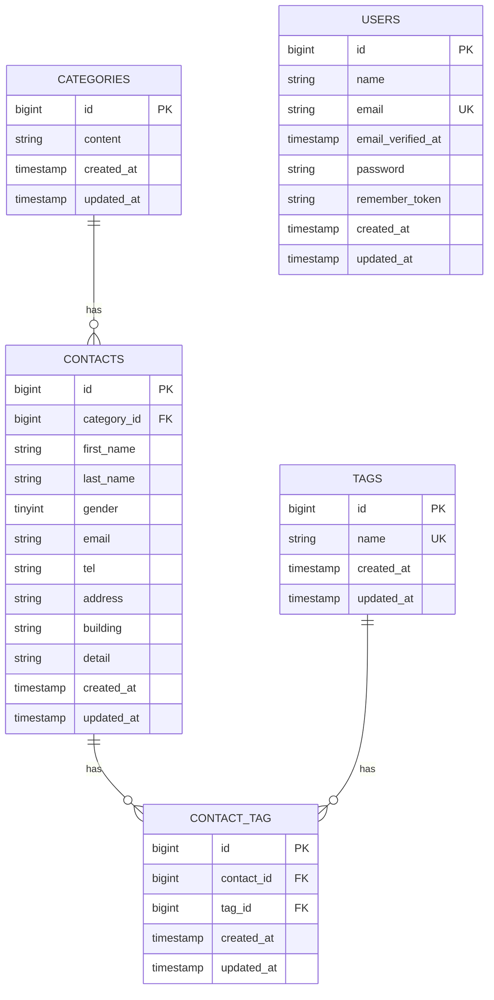

# COACHTECH お問い合わせフォーム

## 概要

Laravelを使用して開発したお問い合わせフォームアプリケーションです。

ユーザー向けのお問い合わせ登録機能に加え、管理者向けのお問い合わせ管理機能を実装しています。

また、REST APIによるお問い合わせ情報の取得・登録・更新・削除にも対応しています。

## 使用技術

| 項目                       | 技術                  |
| -------------------------- | --------------------- |
| OS                         | Docker対応OS          |
| 言語                       | PHP 8.2               |
| フレームワーク             | Laravel 10.x          |
| データベース               | MySQL 8.0             |
| Webサーバー                | Nginx                 |
| フロントエンドビルドツール | Vite                  |
| CSSフレームワーク          | Tailwind CSS ^3.4.0   |
| コンテナ管理               | Docker / Laravel Sail |
| DB管理ツール               | phpMyAdmin            |
| テスト                     | PHPUnit               |
| コード整形                 | Laravel Pint          |

## 主な機能

### お問い合わせ機能

- お問い合わせフォームの表示
- お問い合わせ内容の入力
- 入力内容の確認画面
- 入力値のバリデーション
- お問い合わせ情報の登録
- 登録完了画面の表示

### 管理者機能

- 管理者ログイン
- お問い合わせ一覧表示
- お問い合わせ詳細表示
- お問い合わせの検索・絞り込み
- ページネーション
- お問い合わせの削除
- CSVエクスポート
- タグの登録
- タグの編集
- タグの削除

### API機能

- お問い合わせ一覧取得
- お問い合わせ詳細取得
- お問い合わせ登録
- お問い合わせ更新
- お問い合わせ削除
- リクエストデータのバリデーション
- エラーレスポンスの返却
- 検索・絞り込み・ページネーション

## ディレクトリ構成

```text
contact-form-app/
├── app/
│   ├── Actions/
│   │   └── Fortify/
│   ├── Http/
│   │   ├── Controllers/
│   │   │   ├── Admin/
│   │   │   ├── Api/
│   │   │   └── ContactController.php
│   │   ├── Middleware/
│   │   ├── Requests/
│   │   └── Resources/
│   ├── Models/
│   └── Providers/
├── config/
├── database/
│   ├── factories/
│   ├── migrations/
│   └── seeders/
├── docker/
│   ├── nginx/
│   │   └── default.conf
│   └── php/
│       ├── Dockerfile
│       ├── php.ini
│       ├── start-container
│       ├── supervisord.conf
│       └── www.conf
├── public/
├── resources/
│   ├── css/
│   ├── js/
│   └── views/
├── routes/
│   ├── api.php
│   └── web.php
├── tests/
│   ├── Feature/
│   └── Unit/
├── compose.yaml
├── composer.json
├── composer.lock
├── package.json
├── package-lock.json
├── phpunit.xml
├── tailwind.config.js
└── vite.config.js
```

## ER図



### テーブル説明

| テーブル名  | 説明                             |
| ----------- | -------------------------------- |
| users       | ユーザー・管理者情報             |
| categories  | お問い合わせカテゴリ             |
| contacts    | お問い合わせ情報                 |
| tags        | タグ情報                         |
| contact_tag | お問い合わせとタグの中間テーブル |

### テーブル間のリレーション

- categories と contacts：1対多
- contacts と tags：多対多
- contacts と contact_tag：1対多
- tags と contact_tag：1対多

※ users は上記の他テーブルとの外部キー関係を持ちません。

※ contact_tag テーブルでは、同じお問い合わせに同じタグが重複して紐付かないよう、contact_id と tag_id の組み合わせにユニーク制約を設定しています。

## API仕様

### ベースURL

`/api/v1`

### エンドポイント一覧

| HTTPメソッド | エンドポイント               | 機能                 |
| ------------ | ---------------------------- | -------------------- |
| GET          | `/api/v1/contacts`           | お問い合わせ一覧取得 |
| GET          | `/api/v1/contacts/{contact}` | お問い合わせ詳細取得 |
| POST         | `/api/v1/contacts`           | お問い合わせ登録     |
| PUT          | `/api/v1/contacts/{contact}` | お問い合わせ更新     |
| DELETE       | `/api/v1/contacts/{contact}` | お問い合わせ削除     |

### HTTPステータスコード

| ステータスコード | 内容                   |
| ---------------- | ---------------------- |
| 200              | リクエスト成功         |
| 201              | リソース作成成功       |
| 204              | 削除成功               |
| 404              | 対象データが存在しない |
| 422              | バリデーションエラー   |

## 環境構築

### 動作環境・必要なソフトウェア

- Git
- Docker Desktop
- Docker Compose

### 1. リポジトリのクローン

```bash
git clone https://github.com/ken19-18/contact-form-app.git
cd contact-form-app
```

### 2. 環境変数ファイルの作成

```bash
cp .env.example .env
```

### 3. Dockerイメージのビルド

```bash
docker compose build laravel.test
```

### 4. Composerパッケージのインストール

```bash
docker run --rm \
  -u "$(id -u):$(id -g)" \
  -v "$(pwd)":/var/www/html \
  -w /var/www/html \
  -e COMPOSER_CACHE_DIR=/tmp/composer_cache \
  laravelsail/php82-composer:latest \
  composer install
```

### 5. Dockerコンテナの起動

```bash
./vendor/bin/sail up -d
```

### 6. アプリケーションキーの生成

```bash
./vendor/bin/sail artisan key:generate
```

### 7. データベースのマイグレーション・初期データ登録

```bash
./vendor/bin/sail artisan migrate --seed
```

### 8. npmパッケージのインストール

```bash
./vendor/bin/sail npm install
```

### 9. Viteの起動

```bash
./vendor/bin/sail npm run dev
```

※ Viteを使用する間は、起動したターミナルを開いたままにしてください。

## 管理者ログイン

管理者画面を利用するにはログインが必要です。

### テストユーザー

初期データ登録時に `UserSeeder` によってテストユーザーが登録されます。

| 項目           | 内容               |
| -------------- | ------------------ |
| 名前           | Test User          |
| メールアドレス | `test@example.com` |
| パスワード     | `password`         |

### ログイン方法

アプリケーションにアクセスし、ログイン画面から上記のメールアドレスとパスワードを入力してください。

※ 上記はローカル環境での動作確認専用アカウントです。本番環境では使用しないでください。

## アクセス先

| サービス         | URL                                            |
| ---------------- | ---------------------------------------------- |
| アプリケーション | [http://localhost](http://localhost)           |
| phpMyAdmin       | [http://localhost:8080](http://localhost:8080) |

## テスト

### PHPUnitによるテスト

```bash
./vendor/bin/sail artisan test
```

### Laravel Pintによるコード整形

```bash
./vendor/bin/sail bin pint
```

### Laravel Pintによるコードスタイル検査

```bash
./vendor/bin/sail bin pint --test
```

## Dockerコンテナの停止

```bash
./vendor/bin/sail down
```

## 作成者

後藤 健介
